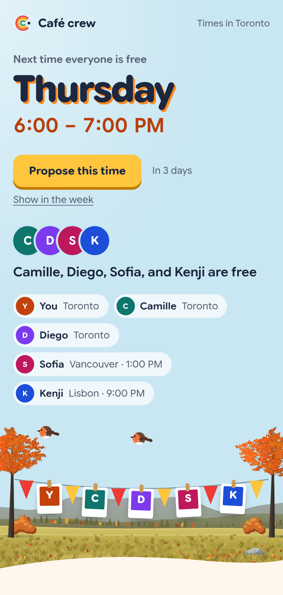
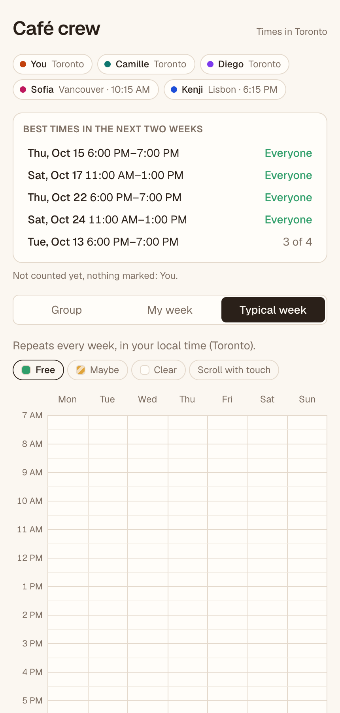
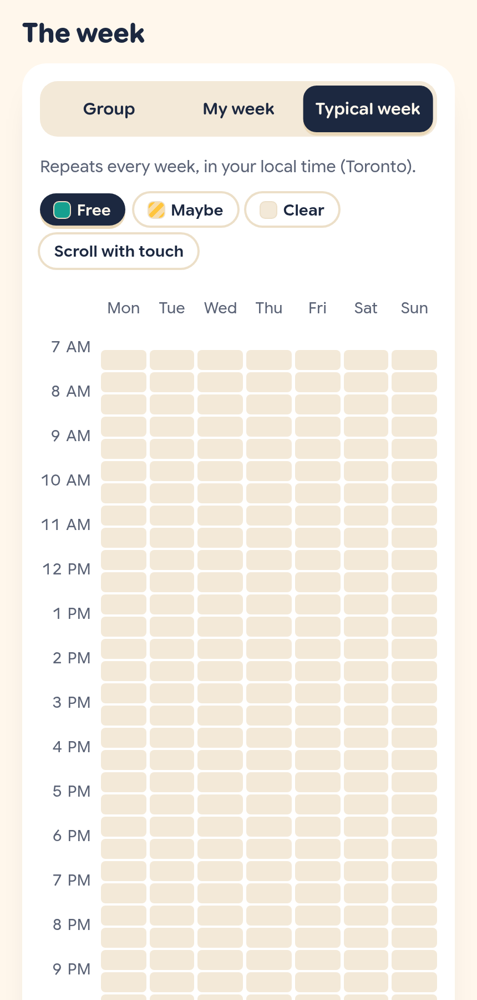
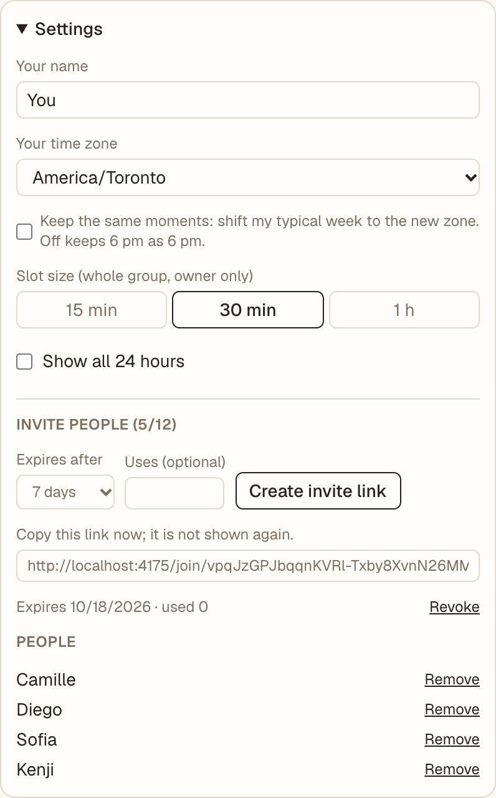
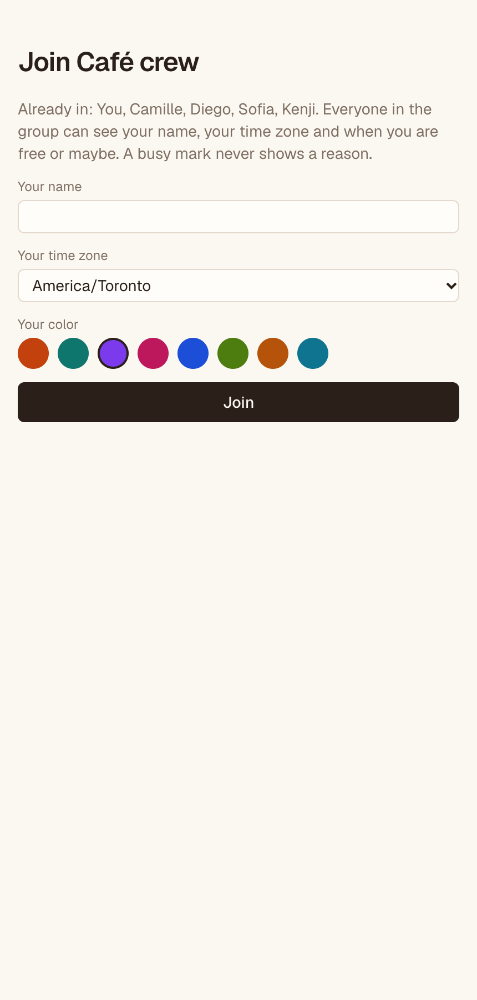

# Cafecito

[](https://github.com/Hoshi-Corp/cafecito/actions/workflows/ci.yml)
[](https://github.com/Hoshi-Corp/cafecito/releases/latest)


A shared availability calendar for a group of friends: everyone marks when they are free, and the group view overlays it into a heatmap.

## Run it

```bash
npm install
npm run dev
```

Open http://localhost:4174. `npm test` runs the tests; `npm test -- --coverage` also enforces the 85% coverage threshold CI requires.

**To host it for your group**, follow the [deployment guide](docs/DEPLOY.md): one server, Docker, a domain, about 30 minutes.

## Screenshots

| Group heatmap and best times | Typical week |
|---|---|
|  |  |

| Create a group | Invite link and members (owner) | Join screen |
|---|---|---|
|  |  |  |

The screenshots come from the demo data (`CAFECITO_DEMO=1`, below).

## Release calendar

| Release | What | Date |
|---|---|---|
| 0.1 | Demo calendar on browser-local data | 2026-10-11 |
| 0.2 | Safer data model: "not set up" state | 2026-10-11 |
| 0.3 | Shared SQLite storage and per-member write API | 2026-10-11 |
| 0.4 | Groups, invite links, real sessions | Built, not released yet |
| 0.5 | Live updates over Server-Sent Events | Built, not released yet |
| 1.0 | Self-hosted release: recovery, rate limits, export, accessibility | Built, not released yet |

Dates are release dates, taken from the git tags. A release ships when its exit criteria in the [roadmap](docs/ROADMAP.md) are met, so unreleased rows have no date.

## Status

Releases 0.4 and 0.5 are built on `main`. Opening the app with no session shows **Create group**: the creator becomes the owner and is signed in with a session cookie. The owner makes invite links in Settings (expiring, optional use limit, revocable) and removes people. A link opens a join screen that says what the group can see (name, time zone, free and maybe time, never a reason for busy); a group holds up to 12 people. Changes show up on everyone's screen within about a second (measured locally; a proxy that buffers the stream slows it), with an "Updated by …" note, and the browser resyncs after a dropped connection. Painting is applied at once and rolled back (the group is reloaded) if the server refuses the write.

**Upgrading from 0.3:** the shared demo group had no owner session, so it cannot be reached any more. Start from a new database (remove the `cafecito-data` volume, or point `CAFECITO_DB` at a new file) and create a group.

**Behind a reverse proxy**, do not buffer `/api/groups/*/events` (nginx: `proxy_buffering off`; the app already sends `X-Accel-Buffering: no`), or live updates arrive late.

**Demo data:** `CAFECITO_DEMO=1 npm run dev` on an empty database seeds the "Café crew" group. Set the cookie `cafecito_session=demo-you` (or `demo-camille`, `demo-diego`, `demo-sofia`, `demo-kenji`) to sign in as that member. Never set this on a server other people can reach: the tokens are public.

**1.0** is built, not released yet. Settings has a **Your account** section: an optional recovery email (when the server has SMTP settings), the list of signed-in devices with **Sign out other devices**, **Export my data** and **Delete my account**. Someone who lost their device asks for a sign-in link from the start page. Invite links, joins, group creation and sign-in are rate-limited per address; sessions unused for 180 days expire. Date-specific availability is stored as ranges and pruned a week after it ends. The grids can be painted from the keyboard (Shift with an arrow paints while moving) and every slot has a screen-reader label. The auth review is in [docs/SECURITY.md](docs/SECURITY.md).

## How availability works

- Availability is stored in 15-minute quanta, so the group's slot size (15 min, 30 min or 1 h) only changes how the grid is drawn and painted.
- Each member has a **typical week** in their own wall-clock time, plus date-specific **overrides** stored as UTC instants.
- Each viewer sees the calendar in their own time zone. A slot counts as free for a member only if they are free for all of it.

The logic lives in `src/lib/availability.ts`.

## Data and backups

The database is created and migrated on first start (`src/server/schema.ts`); demo data is only added with `CAFECITO_DEMO=1`. In Docker it lives in a volume mounted at `/data`. The [deployment guide](docs/DEPLOY.md#4-backups) has a nightly backup script (SQLite's online backup, safe while the app runs) and the restore steps; both were run against the built image for 1.0, and a change made after the backup was gone after the restore.

## CI, releases and Docker

Same strategy as [Jocasta](https://github.com/masaruhoshi/jocasta): one shared test workflow, a CI check on every change, and a manual release that publishes the image.

- **`test.yml`** (reusable): `npm ci`, lint, type-check, `npm test -- --coverage` (fails under 85% coverage). Called by `ci.yml` and `publish.yml`.
- **`ci.yml`**: on every push and pull request to `main`, runs the tests, builds the Docker image without pushing it, and validates `docker-compose.yml`.
- **`publish.yml`**: run by hand from `main` (*Actions → Release → Run workflow*; other branches are skipped) with a bump of `patch`, `minor`, `major` or `none`. It re-runs the tests, refuses to publish if `main` moved since dispatch, pushes `ghcr.io/hoshi-corp/cafecito:latest` (and `:<version>` for a bump), and only then commits the new `VERSION` to `main`, tags `v<version>` and creates the GitHub release. A failed image build leaves no bump, tag or release behind. `none` refreshes `:latest` only. The bump is pushed with a write deploy key (secret `RELEASE_DEPLOY_KEY`) on the `main` ruleset's bypass list, since `main` otherwise only accepts pull requests.
- **Dependabot** checks GitHub Actions, the Dockerfile base images and npm packages weekly.

The `Dockerfile` builds the app and ships only Next.js's standalone server output in a `node:26-alpine` image (non-root, port 4174):

```bash
docker build -t cafecito .
docker run --rm -p 4174:4174 cafecito
# or, with the published image:
docker compose up -d
```

`docker-compose.yml` binds to `127.0.0.1` so a reverse proxy on the host is the public front door. New GHCR packages start private: after the first release, check the package's visibility under the repo's **Packages** tab. `VERSION` is the single source of truth for releases; the version in `package.json` is not bumped.

## Docs

- [Architecture](docs/ARCHITECTURE.md): concepts, rules, data model, target design.
- [Roadmap](docs/ROADMAP.md): releases 0.2 to 1.0 and possible future releases.
- [Deployment guide](docs/DEPLOY.md): install with HTTPS, email, backups, upgrades and upgrade notes.
- [Security](docs/SECURITY.md): review of auth and write paths, known limits, how to report a problem.
